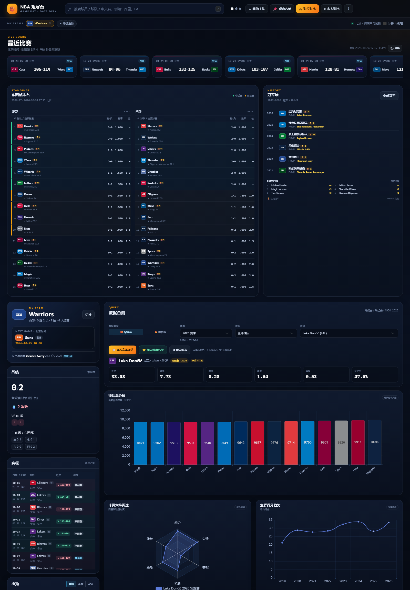

# NBA Gameday Dashboard

> NBA 观赛辅助与数据可视化系统：把“看比赛”和“查数据”放进同一个工作台。
>
> Flask + SQLite + ECharts + 原生 JavaScript，面向球迷与数据分析者的课程项目。



## 功能

- **最近比赛**：ESPN 比分、比赛状态、北京时间、主客队配色，每分钟自动刷新。
- **主队看板**：主队切换、战绩、下一场、赛程、出勤、伤病、阵容。
- **东西部排名**：根据当前赛季已完赛常规赛实时计算，显示胜-负、胜率、差距、季后赛/附加赛分区、当家球星、队史冠军数。
- **冠军墙**：1947–2026 历届总冠军与 FMVP，支持冠军数、FMVP 次数标签和完整列表。
- **球员查询**：数据类型/赛季/球队/球员四级筛选，KPI、六维雷达、生涯趋势、同位置趋势、平行坐标、球队得分榜。
- **对比与观察**：对位对比、多人叠加、观察名单、全局搜索、中文/英文模式。
- **交互细节**：`/` 搜索、`F/W/C/M/?` 快捷键、响应式布局、禁用态、toast 反馈。

## 技术栈

| 层 | 技术 |
|---|---|
| 前端 | HTML5、Bootstrap 5、原生 JavaScript、ECharts 5 |
| 后端 | Flask 3.1、Python 3.11 |
| 数据 | SQLite；Kaggle 历史 CSV、NBA 赛程、ESPN 比分/伤病、冠军数据 CSV |
| 图表 | pyecharts 生成 option，ECharts 浏览器端渲染 |

## 快速开始

要求 Python 3.11+。

```bash
git clone https://github.com/luisclasy/nba-gameday-dashboard.git
cd nba-gameday-dashboard

python -m venv .venv
```

Windows PowerShell：

```powershell
.\.venv\Scripts\python.exe -m pip install -r requirements.txt
.\.venv\Scripts\python.exe app.py
```

macOS / Linux：

```bash
source .venv/bin/activate
pip install -r requirements.txt
python app.py
```

打开 <http://127.0.0.1:5000>。

中文模式可直接访问：

```text
http://127.0.0.1:5000/?cn=1
```

> 仓库自带一份清理过个人偏好的 `database/nba.db` 快照，可直接启动；如果数据库缺失，可先执行 `database/import_data.py`、`database/import_schedule.py` 和 `database/import_champions.py`。

## 数据更新

```powershell
# 最近比分（默认：美东今天 -21 天 ~ +7 天）
.\.venv\Scripts\python.exe database\update_recent_espn.py

# 伤病快照
.\.venv\Scripts\python.exe database\update_injuries_espn.py

# 冠军 / FMVP
.\.venv\Scripts\python.exe database\import_champions.py
```

`update_recent_espn.py` 和 `update_injuries_espn.py` 支持 `--dry-run`，可先预览再写入。

## 项目结构

```text
app.py                         Flask 页面与 JSON API
cn_names.py                    球队/球员中文名与别名
database/
  nba.db                       可直接运行的 SQLite 快照
  schema.sql                   表结构
  import_data.py               历史 CSV 导入
  import_schedule.py           NBA 官方赛程导入
  import_champions.py          冠军 / FMVP 导入
  update_recent_espn.py        ESPN 最近比分增量更新
  update_injuries_espn.py      ESPN 伤病快照更新
data/
  *.csv                        历史数据与冠军数据
templates/                     Jinja2 页面
static/                        CSS / JavaScript / 本地前端库
docs/preview.png               README 预览图
```

## 主要 API

| 接口 | 作用 |
|---|---|
| `/api/recent_games` | 最近比赛、比分、状态 |
| `/api/standings` | 东西部排名、当家球星 |
| `/api/champions` | 冠军、FMVP、冠军数 |
| `/api/players` / `/api/player_detail` | 球员筛选与赛季详情 |
| `/api/radar` / `/api/line` / `/api/parallel` | 雷达、生涯趋势、平行坐标 |
| `/api/compare` / `/api/radar_multi` | 对位、多人对比 |
| `/api/search` | 球员/球队中英文搜索 |
| `/api/injuries` | 伤病快照 |

## 数据来源与说明

- 历史球员/球队/季后赛数据：Kaggle，`data/*.csv`；`player` 表赛季为结束年份（`2026` = 2025-26）。
- 当前赛季赛程：NBA 官方 `scheduleLeagueV2`。
- 最近比分、伤病：ESPN 公开接口（非官方 SDK），页面采用后台刷新和数据库快照回退。
- 冠军/FMVP：ClutchTimes 1947–2026 第三方整理，包含 2026 年尼克斯夺冠 / Jalen Brunson FMVP；正式引用请以 NBA 官方为准。
- 中文名：`cn_names.py`，支持 `BRK/NJN/PHO/CHO/NOH/...` 等历史/异写映射。

本项目仅用于课程学习、研究和技术演示。NBA、ESPN、Kaggle 等数据版权归原权利人所有；代码采用 MIT License，**数据文件不在 MIT 许可范围内**，使用或再分发前请核对原始数据源条款。

## 已知限制

- 排名基于当前赛季已完赛比赛，赛季初样本较小，不代表最终预测。
- 当家球星采用“最近赛季队内场均得分最高且出场 ≥20 场”的启发式规则。
- 比分/伤病是 ESPN 快照，网络失败时显示数据库中的上次结果。
- 默认使用 Flask 开发服务器 + `debug=True`；公开部署请改用 Waitress/Gunicorn，关闭 debug，并配置持久化磁盘。

## License

代码：MIT，见 [LICENSE](LICENSE)。

数据：见 [NOTICE](NOTICE)。
